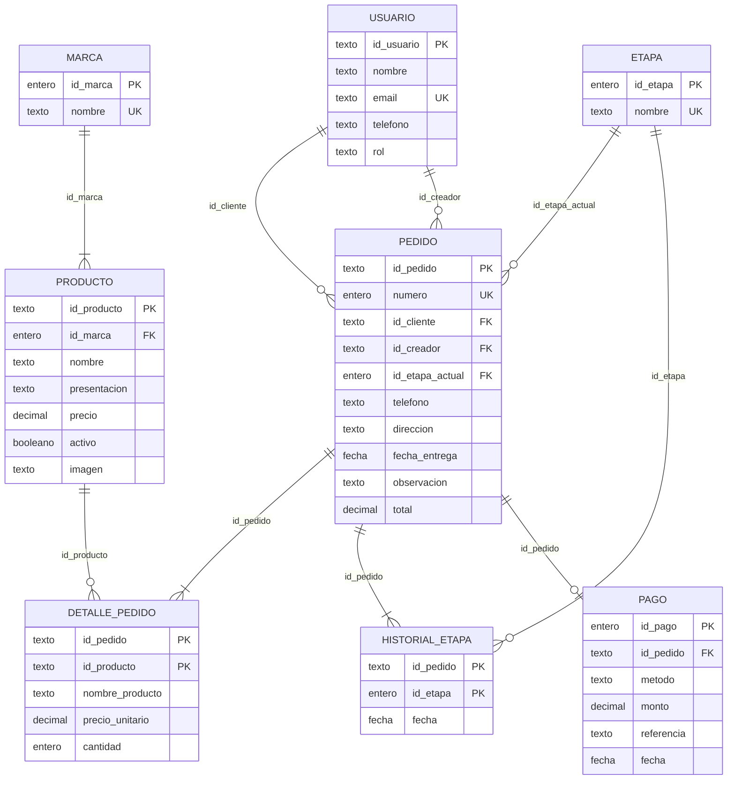

# GEPSAC · Modelo de datos: conceptual, lógico y físico

Los tres niveles describen **la misma base de datos** con distinto detalle:

| Nivel | Pregunta que responde | Cómo se dibuja | Depende de un motor |
|---|---|---|---|
| **Conceptual** | ¿Qué información maneja el negocio y cómo se relaciona? | Notación de Chen: entidades (rectángulo), atributos (óvalo), relaciones (rombo) | No |
| **Lógico** | ¿Cómo se organiza en entidades con sus atributos y relaciones, sin claves foráneas? | Estilo Oracle SQL Developer Data Modeler: `#` identificador, `*` obligatorio, `o` opcional, patas de gallo | No |
| **Físico** | ¿Cómo queda en tablas reales, con tipos de dato y restricciones? | Tablas con tipo de dato, PK/FK/UK y script SQL | Sí |

El proyecto tiene **dos físicos**: el **relacional** (tablas y script SQL, como piden en clase) y el de **Cloud Firestore**, que es el que la app usa de verdad.

Diagramas editables: [`MODELOS_CONCEPTUAL_LOGICO_FISICO.drawio`](MODELOS_CONCEPTUAL_LOGICO_FISICO.drawio), **4 páginas**:
1. Conceptual · 2. Lógico · 3. Físico (relacional) · 4. Físico (Firestore).

El modelo lógico detallado, al estilo Oracle Data Modeler, está en [`MODELO_LOGICO.drawio`](MODELO_LOGICO.drawio). También existe como **diagrama de clases UML** en [`MODELO_LOGICO_UML.drawio`](MODELO_LOGICO_UML.drawio).

### Cardinalidades (revisadas contra el código y el negocio)

| Relación | Cardinalidad | Por qué |
|---|---|---|
| usuario **realiza** pedido (cliente) | 1 : 0..N | Un pedido tiene un solo `clienteId`; un usuario puede no tener pedidos |
| usuario **registra** pedido (creador) | 1 : 0..N | `creadoPor`: el cliente o el administrador; siempre uno |
| etapa **actual de** pedido | 1 : 0..N | Cada pedido tiene un `estado`; una etapa puede no tener pedidos |
| marca **agrupa** producto | 1 : 0..N | Cada producto tiene una marca |
| pedido **contiene** detalle_pedido | 1 : **1..N** | Un pedido **debe** tener al menos un ítem (regla `items.size() > 0`) |
| producto **aparece en** detalle_pedido | 1 : 0..N | Un producto puede estar en muchos pedidos o en ninguno |
| pedido **pasa por** historial_etapa | 1 : **1..N** | Al crearse ya tiene al menos la etapa 0 en `tiempos` |
| etapa **registrada en** historial_etapa | 1 : 0..N | |
| pedido **se paga con** pago | 1 : **0..1** | Un pedido sin pagar no tiene pago; pagado, exactamente uno |

En el diagrama, las relaciones hacia `detalle_pedido` e `historial_etapa` van con **línea sólida** (identificadoras: esas entidades se identifican por su pedido), y las demás con **línea punteada** (no identificadoras).

Scripts SQL del físico relacional: [`sql/modelo_fisico_oracle.sql`](sql/modelo_fisico_oracle.sql) (Oracle 12c) y [`sql/modelo_fisico_postgresql.sql`](sql/modelo_fisico_postgresql.sql).
Detalle de campos y reglas del físico de Firestore: [`MODELO_FIRESTORE.md`](MODELO_FIRESTORE.md).

---

## 1. Modelo conceptual

### Entidades y atributos principales

| Entidad | Atributos | Descripción |
|---|---|---|
| **USUARIO** | nombre, correo, teléfono, rol | Persona con cuenta. El rol es *cliente* o *administrador* |
| **PRODUCTO** | nombre, presentación, precio, activo, imagen | Café que se vende (ej. "Caffe Blend 250 gr") |
| **MARCA** | nombre | Caffe o Kaphiy |
| **PEDIDO** | número, dirección, teléfono, fecha de entrega, observación, total, fecha de creación | Compra de un cliente |
| **PAGO** | método, monto, referencia, fecha | Pago del pedido (Yape, Plin, Transferencia, Tarjeta) |
| **ETAPA** | nombre, orden | Por registrar, Registrado, Pagado, En preparación, Despachado, Entregado |

### Relaciones

| Relación | Entidades | Cardinalidad | Atributos de la relación |
|---|---|---|---|
| **realiza** | USUARIO (cliente) – PEDIDO | 1 : N | |
| **registra** | USUARIO (quien lo crea: cliente o administrador) – PEDIDO | 1 : N | |
| **contiene** | PEDIDO – PRODUCTO | **M : N** | cantidad, precio unitario al comprar |
| **agrupa** | MARCA – PRODUCTO | 1 : N | |
| **se paga con** | PEDIDO – PAGO | 1 : 0..1 | |
| **pasa por** | PEDIDO – ETAPA | **M : N** | fecha en que llegó a la etapa |

**Diagrama (notación de Chen):** página 1 del [`.drawio`](MODELOS_CONCEPTUAL_LOGICO_FISICO.drawio).
Las entidades van en rectángulos naranjas, los atributos en óvalos grises (el identificador va **subrayado**), y cada relación
es un **rombo verde** entre las dos entidades, con su cardinalidad (1, N, M) en cada extremo. Los atributos de una relación
(cantidad y precio al comprar en *contiene*, fecha en *pasa por*) se unen al rombo y no a una entidad. **Pago** es una
*entidad débil* (doble borde): no se identifica por sí sola, depende del pedido.

**Reglas de negocio** (no se ven en el diagrama):
- Un pedido nace en *Por registrar* (si lo crea el cliente) o en *Registrado* (si lo crea el administrador).
- Desde *Registrado* no se avanza hasta que el cliente paga. Desde *Pagado* no se retrocede.
- Solo se elimina un pedido que aún no está pagado.
- Cantidad por producto: 1 a 100. Precio: mayor a 0 y hasta 9999.

---

## 2. Modelo lógico (relacional, 3FN)

Se resuelven las relaciones M:N con tablas intermedias (`detalle_pedido` e `historial_etapa`) y se separa cada dato en su tabla.

**Diagrama:** página 2 del [`.drawio`](MODELOS_CONCEPTUAL_LOGICO_FISICO.drawio), al estilo de Oracle SQL Developer Data Modeler. Cada
entidad muestra solo sus atributos propios (`#` identificador único, `*` obligatorio, `o` opcional) y las relaciones se dibujan con
patas de gallo (línea punteada = opcional). Las **claves foráneas no aparecen** en el diagrama lógico: se agregan al pasar al
físico (página 3). La tabla de abajo sí las lista, para que se vea cómo queda cada relación.

| Tabla | Columnas | Claves y restricciones |
|---|---|---|
| **usuario** | id_usuario, nombre, email, telefono, rol, creado_en | PK id_usuario · UK email · rol ∈ {cliente, admin} · telefono ^9\d{8}$ |
| **marca** | id_marca, nombre | PK id_marca · UK nombre |
| **producto** | id_producto, id_marca, nombre, presentacion, precio, activo, imagen, actualizado_en | PK id_producto · FK id_marca → marca · UK (id_marca, nombre, presentacion) · 0 < precio ≤ 9999 |
| **etapa** | id_etapa, nombre | PK id_etapa (0 a 5) · UK nombre |
| **pedido** | id_pedido, numero, id_cliente, id_creador, telefono, direccion, fecha_entrega, observacion, total, id_etapa_actual, creado_en | PK id_pedido · UK numero · FK id_cliente → usuario · FK id_creador → usuario · FK id_etapa_actual → etapa |
| **detalle_pedido** | id_pedido, id_producto, nombre_producto, precio_unitario, cantidad | PK (id_pedido, id_producto) · FK id_pedido → pedido · FK id_producto → producto · 1 ≤ cantidad ≤ 100 |
| **historial_etapa** | id_pedido, id_etapa, fecha | PK (id_pedido, id_etapa) · FK id_pedido → pedido · FK id_etapa → etapa |
| **pago** | id_pago, id_pedido, metodo, monto, referencia, fecha | PK id_pago · UK id_pedido (1 pago por pedido) · FK id_pedido → pedido · metodo ∈ {Yape, Plin, Transferencia, Tarjeta} |



### Normalización

- **1FN:** no hay listas dentro de un campo. Los productos de un pedido van en `detalle_pedido` y las fechas de cada etapa en `historial_etapa`.
- **2FN:** en `detalle_pedido` y `historial_etapa` todo atributo depende de la clave completa (pedido + producto, pedido + etapa).
- **3FN:** el nombre y el correo del cliente no se repiten en `pedido`; se obtienen por `id_cliente`.
- **Excepción deliberada:** `detalle_pedido.nombre_producto` y `precio_unitario` guardan una *foto* del momento de la compra. No son redundancia: si luego cambia el precio del producto, los pedidos viejos no deben cambiar.

---

## 3. Modelo físico

### 3A. Físico relacional (tablas, tipos de dato y script SQL)

Página 3 del `.drawio`. Es el modelo lógico con tipos de dato reales, claves foráneas (FK) y restricciones. Los tipos del
diagrama son de **Oracle** (`VARCHAR2`, `NUMBER`), como el ejemplo de clase; el script PostgreSQL usa su equivalente.

| Tabla | Clave primaria | Claves foráneas | Únicas |
|---|---|---|---|
| usuario | id_usuario | | email |
| marca | id_marca | | nombre |
| producto | id_producto | id_marca → marca | (id_marca, nombre, presentacion) |
| etapa | id_etapa | | nombre |
| pedido | id_pedido | id_cliente → usuario · id_creador → usuario · id_etapa_actual → etapa | numero |
| detalle_pedido | (id_pedido, id_producto) | id_pedido → pedido · id_producto → producto | |
| historial_etapa | (id_pedido, id_etapa) | id_pedido → pedido · id_etapa → etapa | |
| pago | id_pago | id_pedido → pedido | id_pedido |

- **Scripts:** [`sql/modelo_fisico_oracle.sql`](sql/modelo_fisico_oracle.sql) y [`sql/modelo_fisico_postgresql.sql`](sql/modelo_fisico_postgresql.sql).
  **Ninguno se ha ejecutado en una base real**; probarlos antes de entregar.
- **Diferencias entre motores:** Oracle no tiene `BOOLEAN` (se usa `NUMBER(1)`), guarda la cadena vacía como `NULL` (por eso `observacion` e `imagen` aceptan `NULL`) y no tiene `ON DELETE RESTRICT` (es el comportamiento por defecto).
- **Reglas de cambio de etapa** (no avanzar desde *Registrado*, no retroceder desde *Pagado*): en SQL harían falta un `TRIGGER`; en la app las aplican el código y las reglas de Firestore.

### 3B. Físico en Cloud Firestore (el que usa la app)

Página 4 del `.drawio`. Firestore es NoSQL de documentos: no tiene tablas, joins ni claves foráneas obligatorias. Por eso el modelo lógico se **transforma** al implementarlo:

| Modelo lógico | Implementación en Firestore | Decisión |
|---|---|---|
| usuario | colección `usuarios/{uid}` | El id es el `uid` de Firebase Auth. La contraseña vive en Auth, no aquí |
| producto | colección `productos/{id}` | La imagen va en Base64 dentro del documento (evita Firebase Storage) |
| marca | valor `marca` (texto) en el producto | Lista cerrada de 2 valores; las reglas validan "Caffe" o "Kaphiy" |
| etapa | constante `ESTADOS` en la app y número `estado` (0 a 5) en el pedido | Lista cerrada de 6 valores |
| pedido | colección `pedidos/{id}` | Copia `clienteNombre` y `clienteEmail` para que el administrador no lea `usuarios` |
| detalle_pedido | **arreglo `items`** dentro del pedido | Siempre se leen juntos; es la foto del momento de compra |
| historial_etapa | **mapa `tiempos`** dentro del pedido (clave "0" a "5") | Retroceder borra la clave de la etapa |
| pago | **mapa `pago`** dentro del pedido | Relación 1 a 1 |
| (secuencia de `numero`) | colección `contadores/pedidos` con `{ultimo}` | Se incrementa en una transacción al crear el pedido, así no se repite |

```
usuarios/{uid}      nombre, email, telefono, rol, creadoEn
productos/{id}      nombre, marca, presentacion, precio, activo, imagen, actualizadoEn
pedidos/{id}        numero, clienteId, creadoPor, clienteNombre, clienteEmail, telefono, direccion,
                    fechaEntrega, observacion, total, estado, creadoEn,
                    tiempos{ "0".."5": timestamp },
                    pago{ metodo, monto, referencia, fecha },
                    items[ {productoId, nombre, precio, cantidad} ]
contadores/pedidos  ultimo
```

- **Tipos:** `string`, `number` (entero o decimal), `boolean`, `timestamp`, `map`, `array`.
- **Integridad:** al no haber claves foráneas, la cuidan las **reglas de seguridad** ([`firebase/firestore.rules`](../firebase/firestore.rules)) y la app.
- **Índices:** ninguno adicional. La consulta del cliente es `clienteId == uid` sin ordenar.
- **Límite del documento:** 1 MiB. Un pedido (hasta 50 ítems) y una foto reducida caben de sobra.

Detalle por campo: [`MODELO_FIRESTORE.md`](MODELO_FIRESTORE.md).
