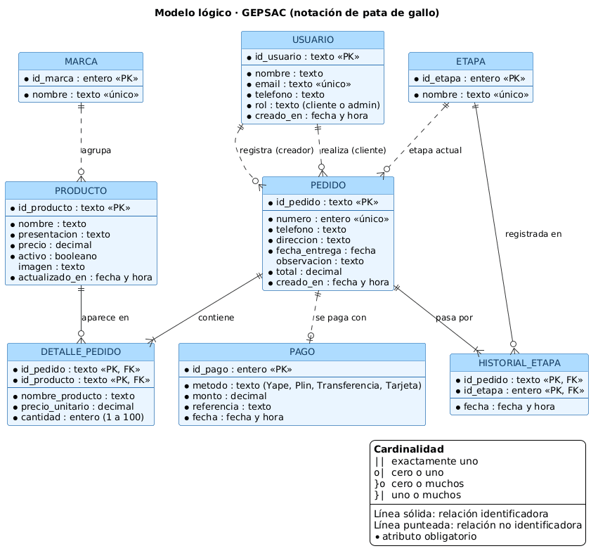
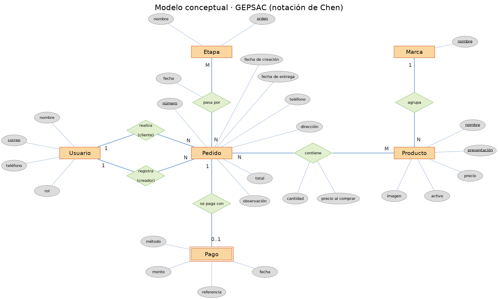

# Diagramas generados con Kroki (PlantUML y GraphViz)

Versión renderizada de los modelos conceptual y lógico de GEPSAC, además de los `.drawio` editables de la carpeta `docs/`.
Los scripts (`.puml`, `.dot`) son la fuente: si cambia el modelo, se editan y se vuelven a renderizar.

## 1. Modelo lógico (pata de gallo)

- **Archivos:** `modelo-logico-gepsac.puml` (fuente), `.png` y `.svg`.
- **Tipo elegido:** PlantUML con entidades (`entity`). Dibuja las patas de gallo de forma nativa: `||` uno, `o|` cero o uno, `}o` cero o muchos, `}|` uno o muchos.
- **Línea sólida** = relación identificadora (`DETALLE_PEDIDO`, `HISTORIAL_ETAPA` se identifican por su pedido). **Punteada** = no identificadora.
- **`*`** marca el atributo obligatorio; los opcionales (`observacion`, `imagen`) van sin asterisco.
- **Cardinalidades revisadas contra el código:** un pedido debe tener al menos un ítem (`}|`, regla `items.size() > 0`) y al menos una etapa en el historial; el pago es `0..1`.

## 2. Modelo conceptual (notación de Chen)

- **Archivos:** `modelo-conceptual-gepsac.dot` (fuente), `.png` y `.svg`.
- **Tipo elegido:** GraphViz (`neato`) con todos los elementos en posición fija. PlantUML no tiene notación de Chen (rombos y óvalos de atributo).
- **Rectángulo** = entidad (doble borde en *Pago*: entidad débil, depende del pedido). **Óvalo** = atributo (el identificador va subrayado). **Rombo** = relación. **1 / N / M / 0..1** = cardinalidad.
- *contiene* y *pasa por* llevan sus propios atributos (cantidad, precio al comprar, fecha).

## Notas

- Se renderizó con el servicio público **Kroki.io**: el texto de los diagramas viaja a ese servidor. Estos modelos no contienen datos personales.
- El conceptual es ancho a propósito, como el ejemplo de clase; en el `.svg` se puede ampliar sin perder calidad.
- Los diagramas de `docs/*.drawio` siguen siendo la versión editable en draw.io.
